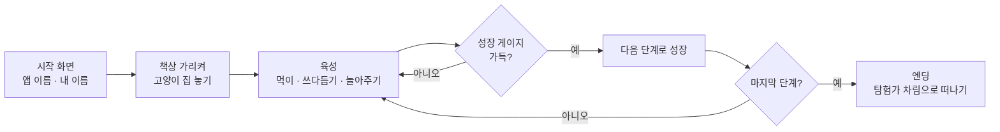

# XR 개인 프로젝트 컨셉 기획서

| 항목 | 내용 |
|---|---|
| 작성자 | 송은빈 |
| 주제 | **C. MR 기능을 활용한 MR 앱** |
| 플랫폼 | Meta Quest (Android 빌드) |
| 엔진 | Unity 6000.3.15f1 · URP 17.3 |
| 일정 | 11/16 컨셉 기획서 제출 · 11/23 1차 빌드 및 시연 영상 제출 |

---

## 1. 앱 이름

**Here, Kitty! — A tiny cat on your desk** (가제)

## 2. 한 줄 소개

내 책상 위에 사는 작은 고양이를 먹이고 쓰다듬고 놀아 주며 키우는 MR 펫 육성 앱.

## 3. 핵심 경험 

> **"진짜 내 책상 위에 고양이가 살고 있다."**

고양이가 현실 책상의 크기와 가장자리를 알고 그 위를 돌아다니며, 내가 손으로 주는 먹이와 손길에 반응한다.

## 4. 사용한 XR 기능

| 기능 | 쓰는 곳 |
|---|---|
| 패스스루 (AR Foundation · Meta OpenXR) | 현실 방 위에 고양이를 띄움 |
| 평면 인식 (책상 · 바닥) | 고양이 집 배치, 이동 범위, 가장자리 판단 |
| 레이캐스트 | 컨트롤러로 책상을 가리켜 고양이 집을 놓을 위치 지정 |
| 앵커 | 놓은 고양이 집을 현실 위치에 고정 |
| XRI 잡기 (Grab) | 먹이 · 장난감을 집어서 주기 |
| XRI 소켓 (Socket) | 먹이를 밥그릇에 넣기 |
| XRI 포크 / 호버 | 고양이 쓰다듬기 |

## 5. 플레이 흐름

1. **시작**: 앱 이름과 제작자 이름이 나오는 시작 화면.
2. **배치**: 컨트롤러 레이로 책상 평면을 가리키고 트리거를 누르면 그 자리에 고양이 집이 놓이고 고양이가 나타난다.
3. **육성**: 고양이의 상태(배고픔 · 기분 · 졸림)를 보고 알맞게 돌봐 준다.
4. **성장**: 잘 돌보면 성장 게이지가 차고, 가득 차면 다음 단계로 자란다 (아기 → 어린이 → 어른, 3단계).
5. **엔딩**: 어른이 되면 등산 모자와 가방을 멘 탐험가 차림으로 손을 흔들며 떠나고, 결과 화면(돌본 시간 · 먹인 횟수)으로 끝난다.

## 6. 주요 기능

### 6-1. 책상 위 생활 (현실 공간 연동)
- 고양이는 인식된 **책상 평면 안에서만** 돌아다닌다.
- 가장자리에 다다르면 멈칫하고(`Alert`) 방향을 바꾼다. 떨어지지 않는다.
- 상태에 따라 앉아 쉬기 · 자기 · 네 발로 걷기를 오간다.

### 6-2. 돌봄 상호작용
| 행동 | 조작 | 고양이 반응 (에셋 애니메이션) |
|---|---|---|
| 먹이 주기 | 먹이를 집어 밥그릇(소켓)에 넣기 | 밥그릇으로 걸어가 먹기 (`Quadruped_Eating`) |
| 쓰다듬기 | 컨트롤러/손을 머리 위에 대기 | 좋아하기 (`Cute1`), 기분 상승 |
| 재우기 | 졸림이 높을 때 집 근처에 두기 | 자기 (`Sleep`) |
| 무시하기 | 오래 안 돌봄 | 지침 · 화남 (`Tired`, `Angry`) |
| 인사 | 처음 등장 · 성장 직후 (어린이 단계부터) | 손 흔들기 (`Hi`), 기뻐하기 (`Victory`) |

### 6-3. 상태와 성장
- 상태값 3개: **배고픔 · 기분 · 졸림** (시간에 따라 변함, 머리 위 작은 아이콘으로 표시).
- 상태를 알맞게 채워 주면 **성장 게이지**가 오른다.

**상태는 표정으로 보여 준다.** 에셋의 얼굴 텍스처 27종(`T_Chibi_Emo_01`~`27`) 중 상태에 맞는 것을 골라, 얼굴 머티리얼만 바꿔 끼운다.

| 상태 | 표정 |
|---|---|
| 배고픔 높음 | 시무룩한 얼굴 |
| 기분 좋음 (쓰다듬은 직후 등) | 웃는 얼굴 |
| 졸림 높음 | 감은 눈 |
| 평소 | 기본 얼굴 |

> 27종 각각이 어떤 표정인지는 Unity에서 머티리얼을 하나씩 확인해 고른다.

**성장은 "크기 + 행동 + 소품"으로 보여 준다.** 모델은 하나(`Chibi_Cat`)뿐이므로, 단계마다 크기를 키우고 **할 수 있는 행동이 늘어나게** 한다.

| 단계 | 크기 | 할 수 있는 행동 (에셋 애니메이션) | 소품 |
|---|---|---|---|
| 아기 | 0.6배 | 네 발로 걷기 · 먹기 · 자주 졸기 (`Quadruped_Walk`, `Quadruped_Eating`, `Sleep`) | 없음 |
| 어린이 | 0.8배 | + 일어서기 · 인사 · 쓰다듬으면 좋아하기 (`Hi`, `Cute1`, `Jump`) | 바람개비 (`Whirligig_A`) |
| 어른 | 1배 | + 땅 파서 간식 찾기 · 기뻐하기 (`DigA`, `Victory`) | 등산 모자 · 가방 (`Hiking_hat_A`, `Bag_bread`) |

- 단계가 오를 때마다 `Victory` 연출과 함께 새로 할 수 있게 된 행동을 바로 한 번 보여 준다.
- 단계별로 허용하는 애니메이터 상태를 나눠 두고, 성장하면 허용 범위를 넓히는 구조로 만든다.

### 6-4. 간식 찾기 이벤트 (목표 기능)
- **어른 단계에서 새로 생기는 능력.** 고양이가 땅을 파는 동작(`DigA`)을 하고 나면 **바닥 평면 어딘가**에 간식(`Dried_fish`)이 숨겨진다.
- 플레이어가 직접 돌아다니며 찾아 집은 뒤 고양이에게 가져다주면 성장 게이지 보너스.
- 몸을 움직여 현실 공간을 탐색하는 재미를 더하는 이벤트.

## 7. 현실 공간이 다를 때의 대비

| 상황 | 대처 |
|---|---|
| 책상이 인식되지 않음 | 바닥 평면에 가상 방석을 깔고 그 위에서 생활 |
| 바닥 외 평면이 하나도 없음 | 플레이어 앞 바닥 1.5m 지점에 자동 배치 |
| 간식 숨길 곳 | 바닥 평면 중 플레이어 주변 2~3m 안에서만 고름 |

- 시연 전에 헤드셋 **공간 설정(Space Setup)** 에서 책상 · 벽 · 바닥을 등록해 둔다.

## 8. 개발 범위

| 구분 | 내용 |
|---|---|
| **필수** (1차 빌드에 반드시) | 패스스루, 책상 평면 인식 + 레이캐스트 배치, 평면 안 이동 + 가장자리 멈춤, 먹이 주기 · 쓰다듬기, 상태값 3개, 성장 3단계, 시작 · 엔딩 화면 |
| **목표** | 간식 찾기 이벤트(바닥), 재우기, 무시했을 때 반응, 앵커 고정 |
| **여유가 되면** | 장난감 공 던지기, 손 추적(XR Hands)으로 쓰다듬기, 효과음 · 파티클 다듬기 |

## 9. 일정

| 날짜 | 작업 |
|---|---|
| 11/16 | 컨셉 기획서 제출 |
| 11/17 | Quest 빌드 확인, **패스스루가 녹화에 담기는지 확인**, 평면 인식 · 레이캐스트 배치 |
| 11/18 | 고양이 이동(평면 안 · 가장자리), 애니메이터 상태 구성 |
| 11/19 | 먹이 주기(잡기 · 소켓) · 쓰다듬기, 상태값 |
| 11/20 | 성장 단계 · 시작 · 엔딩 화면, 공간 대비 규칙 |
| 11/21 | 간식 찾기 이벤트, 효과음 · UI 다듬기 |
| 11/22 | 최적화 · 버그 수정, 시연 영상 녹화 · 편집 |
| 11/23 | 1차 빌드 및 시연 영상 제출 |

## 10. 예상 위험과 대응

| 위험 | 대응 |
|---|---|
| 5일로 부족할 수 있음 (지시서 경고) | 필수 / 목표 / 여유 범위를 나눠, 필수부터 끝까지 완성 |
| 녹화에 패스스루가 안 담김 | 1일차에 바로 확인 |
| 공간 인식이 불안정 | 7장의 대체 규칙 + 시연 전 Space Setup |
| 성능 저하 | 고양이 1마리 · 로우폴리 소품만 사용, 실시간 조명 최소화 |
| 멀미 | 플레이어 이동은 현실 걸음만 사용, 카메라 강제 이동 없음 |
